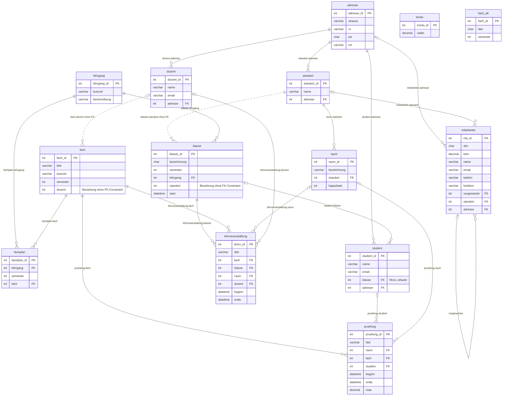

# 05 Repo-Inventar: SQL/ und Python/kap-1, kap-5 bis kap-12

Kurs DBWE.TA1A «Datenbanken und Web-Entwicklung», IFA Höhere Fachschule. Grundlage: Fork IFA_DBWE, Stand Commit 9cf489a «Changes January 2024». Erstellt am 29.09.2026 für den Kurs-Rework (KT1 bis KT3). Lehrmittel von Jochen Reinholdt (DBSQL, PYGR).

Inhalt:

1. Gelesener Umfang und Methode
2. Schema-Dokumentation «beispiele» (Struktur, Mermaid-ERD, Datenstatistik, Datenqualität, Kompatibilität, Nutzbarkeit für U2/U3)
3. Inventar SQL-Kapiteldateien
4. Inventar Python kap-1, kap-5 bis kap-12
5. Verbrauchte Szenarien und Aufgabentypen
6. Abgleich mit Handoff v2.0, Abschnitt «Repo-Material» (Zeilen 53-86)
7. Findings

---

## 1. Gelesener Umfang und Methode

### 1.1 Gelesene Dateien (alle vollständig)

| Bereich | Dateien | Umfang |
|---|---|---|
| SQL/create_beispiele.sql | 1 | 443 Zeilen, 614'929 Bytes; alle 14 CREATE TABLE und alle 14 INSERT-Statements (per Parser vollständig ausgewertet, 8'391 Datensätze) |
| SQL/kap-3.sql bis kap-10.sql | 7 (kap-3, 4, 5, 6, 7, 8, 10; kap-9.sql existiert nicht) | 664 Zeilen, 140 Statements |
| Python/kap-1 | 2 | addition.py (leer), hello.py |
| Python/kap-5 | 8 | |
| Python/kap-6 | 11 | inkl. leerer module.py |
| Python/kap-7 | 12 | |
| Python/kap-8 | 3 | |
| Python/kap-9 | 2 | |
| Python/kap-10 | 16 | |
| Python/kap-11 | 7 | |
| Python/kap-12 | 6 | |
| **Total** | **8 SQL + 67 Python = 75 Dateien** | |

Zusätzlich gelesen: Handoff v2.0, Zeilen 40-99 (Kontext um den Abschnitt «Repo-Material»).

### 1.2 Methode

- **Dump-Analyse:** eigener Python-Parser über die INSERT-Statements, Laden in eine SQLite-Kopie im Scratchpad, Qualitätsabfragen (Duplikate, verwaiste FK-Werte, NULL-Verteilung, Konsistenz).
- **Import- und Ausführungstest:** MariaDB 10.11.14 (Ubuntu-Paket) mit Datenverzeichnis im Scratchpad. Original-Dump importiert (bricht ab), danach Kopie mit ersetzter Collation. kap-3 bis kap-10 mit `--force` ausgeführt, einzeln auf frischer DB und kumulativ, zusätzlich mit MySQL-8-Standard-`sql_mode` (inkl. `ONLY_FULL_GROUP_BY`). Exakte Zeilenzahlen per `COUNT(*)` in MariaDB bestätigt.
- **Kein MySQL-8-Server verfügbar.** Aussagen zu MySQL-8-spezifischem Verhalten (view_table_usage, Rollen mit Host-Teil, Spalten in mysql.user) stützen sich auf Dokumentationswissen und sind als solche markiert.
- **Python:** alle 67 Dateien mit Python 3.11.15 und 3.12 kompiliert (`-W error`), über 100 Läufe mit stdin-Eingaben (Normal- und Randfälle) in einer Kopie im Scratchpad; what_time.py mit simulierten Uhrzeiten. Ergebnisse 3.11 und 3.12 identisch.
- **Einordnung Beispiel/Buchaufgabe:** Das Repo kennzeichnet Python-Aufgaben nicht. Die Einordnung stützt sich auf Kommentare, Docstrings (Aufgabentext) und Muster und ist mit «vermutl.» markiert; bei SQL sind Aufgaben per Kommentar gekennzeichnet (z. B. «Kap. 4.3.4 Aufgabe 1»). Abgleich mit PYGR/DBSQL steht aus.
- Im Repo wurde ausser dieser Datei nichts angelegt oder geändert.

---

## 2. Schema-Dokumentation «beispiele»

### 2.1 Eckdaten des Dumps

| Merkmal | Wert |
|---|---|
| Erzeugt mit | mysqldump 8.0.34 (macOS arm64), Server 8.2.0, Dump vom 19.01.2024 |
| Datenbank | `CREATE DATABASE IF NOT EXISTS beispiele` + `USE beispiele` (Zeilen 1-2), je Tabelle `DROP TABLE IF EXISTS` |
| Zeichensatz / Collation | utf8mb4 / utf8mb4_0900_ai_ci (DB und alle 14 Tabellen); Verbindung `SET NAMES utf8` (Zeile 12) |
| Engine | InnoDB (alle Tabellen) |
| Import-Einstellungen | `FOREIGN_KEY_CHECKS=0`, `UNIQUE_CHECKS=0`, `SQL_MODE='NO_AUTO_VALUE_ON_ZERO'` während des Imports |
| Datenumfang | 14 Tabellen, 8'391 Datensätze, je Tabelle ein Extended-INSERT (längste Zeile 405'902 Zeichen) |
| Nicht enthalten | Views, Trigger, Prozeduren, UNIQUE-Constraints, CHECK-Constraints, Sekundärindizes ausser den FK-Indizes |
| Constraints | 14 Primärschlüssel (alle `int AUTO_INCREMENT`), 18 deklarierte Fremdschlüssel |

### 2.2 Tabellenstruktur

Legende: NN = NOT NULL, AI = AUTO_INCREMENT-Startwert im Dump.

| Tabelle | Spalten (Typ) | PK | FK-Constraints | Indizes | AI |
|---|---|---|---|---|---|
| adresse | adresse_id int NN; strasse varchar(255); nr varchar(255); plz char(4) NN; ort varchar(255) NN | adresse_id | keine | PK | 163 |
| dozent | dozent_id int NN; name varchar(255) NN; email varchar(255) NN; adresse int NN | dozent_id | adresse → adresse.adresse_id (dozent_ibfk_1) | PK, adresse | 15 |
| fach | fach_id int NN; titel varchar(255) NN; kuerzel varchar(4) NN; semester int NN; dozent int | fach_id | **keiner** (dozent ist Beziehung zu dozent ohne Constraint) | PK | 26 |
| fach_alt | fach_id int NN; titel char(80) NN; semester int | fach_id | keine | PK | 7 |
| fachplan | fachplan_id int NN; lehrgang int NN; semester int NN; fach int NN | fachplan_id | fach → fach (fachplan_ibfk_1); lehrgang → lehrgang (fachplan_ibfk_2) | PK, fach, lehrgang | 32 |
| klasse | klasse_id int NN; bezeichnung char(20) NN; semester int NN; lehrgang int NN; standort int NN; start datetime NN | klasse_id | lehrgang → lehrgang (Constraint-Name `lehrgang`); **standort ohne Constraint** | PK, lehrgang_idx | 31 |
| konto | konto_id int NN; saldo decimal(8,2) | konto_id | keine | PK | 3 |
| lehrgang | lehrgang_id int NN; kuerzel varchar(5) NN; beschreibung varchar(255) | lehrgang_id | keine | PK | 4 |
| lehrveranstaltung | lehrv_id int NN; titel varchar(255) NN; fach int NN; klasse int NN; raum int; dozent int; beginn datetime; ende datetime | lehrv_id | fach → fach; klasse → klasse; raum → raum; dozent → dozent (ibfk_1 bis 4) | PK, fach, klasse, raum, dozent | 103578 |
| mitarbeiter | ma_id int NN; ahv char(15); lohn decimal(7,2); name varchar(255); email varchar(255); telefon varchar(50); funktion varchar(255); vorgesetzter int; standort int; adresse int | ma_id | standort → standort (ON DELETE RESTRICT ON UPDATE CASCADE); adresse → adresse; vorgesetzter → mitarbeiter.ma_id (Selbstbezug) | PK, standort, adresse, vorgesetzter | 10 |
| pruefung | pruefung_id int NN; titel varchar(255) NN; raum int; fach int NN; student int; beginn datetime; ende datetime; note decimal(2,1) | pruefung_id | fach → fach; student → student; raum → raum (ibfk_1 bis 3) | PK, fach, student, raum | 90254 |
| raum | raum_id int NN; bezeichnung varchar(255) NN; standort int NN; kapazitaet int NN | raum_id | standort → standort (ON UPDATE CASCADE) | PK, standort | 26 |
| standort | standort_id int NN; name varchar(255) NN; adresse int NN | standort_id | adresse → adresse | PK, adresse | 100 |
| student | student_id int NN; name varchar(255) NN; email varchar(255) NN; klasse int; adresse int NN | student_id | klasse → klasse (student_ibfk_1); adresse → adresse (student_ibfk_2) | PK, klasse, adresse | 355 |

Hinweise zur Struktur:

- FK-Spalten heissen wie die referenzierte Tabelle (`student.klasse`, nicht `klasse_id`). Das ist für ERD- und JOIN-Übungen gut lesbar, weicht aber von der verbreiteten Konvention `..._id` ab.
- Namen von Personen stehen in einer Spalte (`name` = «Vorname Nachname») in student, dozent und mitarbeiter. Das ist ein Diskussionspunkt für 1NF (Atomarität) und unterscheidet sich vom Demo-Schema in kap-3.sql (`name` + `vorname`).
- `pruefung.note decimal(2,1)` lässt Werte bis 9.9 zu; es gibt keinen CHECK auf 1.0-6.0.
- Nur zwei FK-Aktionen sind deklariert (mitarbeiter.standort, raum.standort); alle anderen FKs nutzen den Standard (RESTRICT/NO ACTION).

### 2.3 ERD (Mermaid, nur Struktur)

Durchgezogene Linie = deklarierter FK-Constraint. Gestrichelte Linie = Beziehung ohne FK-Constraint. konto und fach_alt haben keine Beziehungen.

Beziehungsmuster für den Unterricht: drei M:N-Beziehungen über Zwischentabellen (lehrgang/fach über fachplan, klasse/fach über lehrveranstaltung, student/fach über pruefung), ein Selbstbezug (mitarbeiter.vorgesetzter), adresse als gemeinsam genutzte Tabelle von vier Tabellen.

### 2.4 Datenstatistik

Zeilenzahlen per Parser gezählt und in MariaDB per `COUNT(*)` bestätigt.

| Tabelle | Zeilen | ID-Bereich | NULL-Werte (tatsächlich) | Bemerkung |
|---|---|---|---|---|
| adresse | 160 | 1-160 | keine | 81-160 exakte Kopie von 1-80 (siehe 2.5); Orte: Zürich 40, St. Gallen 40, Bern, Basel, Olten, Aarau je 20; nur CH-Orte |
| dozent | 14 | 1-14 | keine | alle 14 unterrichten mind. 1 Fach; 9 Dozierende haben 2-3 Fächer |
| fach | 24 | 1-25, ID 4 fehlt | keine | Semester 1-6; alle 24 im Fachplan, mit Lehrveranstaltungen und Prüfungen |
| fach_alt | 6 | 1-6 | keine | ohne Beziehung; 2 Titel auch in fach |
| fachplan | 31 | 1-31 | keine | HFSNT 15, HFWI 16, HFAPP 0 Einträge |
| klasse | 30 | 1-30 | keine | je 5 Klassen pro Semester 1-6; Zürich 12, Bern 12, St. Gallen 6, Basel 0; Start 01.07.2021 bis 01.01.2024 |
| konto | 2 | 1-2 | keine | Saldi 5000.00 und 40000.00; keine Beziehung |
| lehrgang | 3 | 1-3 | keine | HFSNT, HFWI, HFAPP |
| lehrveranstaltung | 2'310 | 101268-103577 | dozent: 3 | 75-80 je Klasse, alle 4 h; 01.07.2021 bis 15.12.2026 |
| mitarbeiter | 9 | 1-9 | vorgesetzter: 1 | 3 Hierarchiestufen; je Standort 1-4 Personen |
| pruefung | 5'421 | 83016-90249 (mit Lücken) | keine | 15 bis 16 je Student; alle 3 h; 09.08.2021 bis 14.11.2028; Note 2.8-6.0, Schnitt 4.42, 1'920 Noten unter 4 |
| raum | 25 | 1-25 | keine | Zürich 12, Bern 7, St. Gallen 4, Basel 2; Kapazität 10-25; Bezeichnungen je Standort eindeutig, standortübergreifend nicht (R001 viermal) |
| standort | 4 | 1, 2, 3, 9 | keine | AUTO_INCREMENT steht auf 100 |
| student | 352 | 1-352 | keine | 3-17 je Klasse; HFSNT 211, HFWI 141; Zürich 143, Bern 150, St. Gallen 59 |
| **Total** | **8'391** | | | |

Nullable Spalten ohne einen einzigen NULL-Wert: adresse.strasse/nr, fach.dozent, fach_alt.semester, lehrgang.beschreibung, lehrveranstaltung.raum/beginn/ende, alle mitarbeiter-Spalten ausser vorgesetzter, pruefung.raum/student/beginn/ende/note, konto.saldo, **student.klasse** (nullable, aber 0 NULL).

### 2.5 Datenqualität

**Verwaiste FK-Werte:** keine. Alle 20 Beziehungen (18 deklarierte und 2 nicht deklarierte) wurden geprüft; kein Wert zeigt ins Leere.

**Duplikate und Mehrfachnutzung**

- adresse 81-160 ist Feld für Feld identisch mit 1-80 (ID + 80). 80 Adressen werden von keiner Tabelle referenziert (79 aus dem Duplikatblock plus ID 1). Einzige Referenz in den Duplikatblock: ein Mitarbeitender auf ID 99.
- 73 Adressen werden von mehreren Studierenden genutzt (bis 9 Studierende pro Adresse); 14 Adressen teilen sich Studierende und Dozierende, 7 Studierende und Mitarbeitende. Für ERD-Diskussionen (1:n statt 1:1) brauchbar, realistisch ist es nicht.
- student: 2 Namenspaare mit identischer E-Mail-Adresse, aber unterschiedlicher Klasse und Adresse (IDs 2/68 und 14/92). Es gibt keinen UNIQUE-Constraint auf E-Mail (in keiner Tabelle).
- fach_alt enthält «Linux und BASH Grundlagen» mit derselben ID 6 wie in fach, daher entfernt `UNION` in kap-4 genau eine Zeile (29 statt 30).

**Nicht deklarierte Beziehungen**

- `klasse.standort` → standort (alle Werte gültig: 1, 2, 3)
- `fach.dozent` → dozent (alle Werte gültig)

**Abdeckung für LEFT JOIN / «ohne»-Abfragen**

| Fall | Anzahl | Verwendbar für U2.3 |
|---|---|---|
| Lehrgang ohne Klasse (HFAPP) | 1 | ja |
| Lehrgang ohne Fachplan (HFAPP) | 1 | ja |
| Standort ohne Klasse (Basel 1) | 1 | ja |
| Raum ohne Lehrveranstaltung | 15 von 25 | ja (bereits in kap-5 Aufgabe 4 für Bern verwendet) |
| Raum ohne Prüfung | 17 von 25 | ja |
| Lehrveranstaltung ohne Dozent (alle ITAR1) | 3 | nur als Demo, ist Buchbeispiel kap-4 Kap. 4.4 |
| Mitarbeitende ohne Vorgesetzte | 1 | ja, ist aber Buchbeispiel Self-Join kap-4 Kap. 4.5 |
| Adresse ohne Referenz | 80 | ja (hängt mit Duplikaten zusammen) |
| Klasse ohne Studierende | 0 | **nein** |
| Studierende ohne Klasse | 0 | **nein** (Spalte nullable, aber gefüllt) |
| Fach ohne Prüfung / ohne Lehrveranstaltung / ohne Fachplan | 0 / 0 / 0 | **nein** |
| Dozent ohne Fach / ohne Lehrveranstaltung | 0 / 0 | **nein** |
| Studierende ohne Prüfung | 0 | **nein** |

**Inhaltliche Inkonsistenzen**

- pruefung: jede und jeder Studierende hat eine Prüfung in **allen** Fächern des eigenen Lehrgangs, auch in Semestern, die die Klasse noch nicht erreicht hat (2'177 Prüfungen mit Fachsemester > Klassensemester). Prüfungsdaten reichen bis 14.11.2028; 3'495 Prüfungen liegen nach dem Dumpdatum und haben trotzdem eine Note. Am KT1 (23.10.2026) liegen noch 816 benotete Prüfungen in der Zukunft, aber nur noch 30 Lehrveranstaltungen.
- Notenverteilung nahezu gleichverteilt 2.8-6.0; 35 % ungenügend; nur 1 von 352 Studierenden hat keine ungenügende Note. Für GROUP BY-Übungen ergiebig, für «realistische» Interpretationen ungeeignet.
- lehrveranstaltung: 6 Einträge mit anderem Dozenten als fach.dozent, 3 ohne Dozent; 2 Raum-Doppelbelegungen und 3 Dozierenden-Doppelbelegungen (exakt gleicher Beginn). Diese Konflikte sind Gegenstand von Buchaufgaben (kap-4 Kap. 4.8 Aufgabe 2 und 3).
- lehrgang.beschreibung (ID 2) enthält ein unsichtbares weiches Trennzeichen (U+00AD) mitten im Wort «Wirtschaftsinformatiker». `LIKE '%Wirtschaftsinformatiker%'` und `=` liefern in MariaDB 10.11 (utf8mb4_unicode_ci) und SQLite 0 Treffer; MySQL 8 nicht getestet.
- Tippfehler in Daten: fach 18 «Apllikationsarchitektur», fach 24 «Risikomangement», mitarbeiter.funktion «Geamtschulleiterin» und «Standordleitung» (neben korrektem «Standortleitung»; `GROUP BY funktion` bildet dadurch zwei Gruppen).
- mitarbeiter.ahv: Format «NNN.NN.NNN.NNN» (14 Zeichen) ohne Präfix 756; die echte AHV-Nummer (756.XXXX.XXXX.XX, 16 Zeichen) passt nicht in char(15).
- E-Mail-Adressen aller 375 Personen nutzen dieselbe Domain (möglicherweise real registriert); fiktive Personennamen.

**Redundanzen (Material für 3NF in U2)**

- `klasse.bezeichnung` (z. B. «HFSNT.ZH.6») codiert Lehrgang und Standort, die zusätzlich als Spalten vorliegen.
- `klasse.semester` ist aus `start` ableitbar und auf Stand Januar 2024 eingefroren (im Oktober 2026 veraltet).
- `fach.semester` ist in allen 31 Fachplan-Zeilen identisch mit `fachplan.semester`.
- `pruefung.titel` = Fachkürzel + «-PR», `lehrveranstaltung.titel` = Fachkürzel + laufende Nummer.
- `lehrveranstaltung.dozent` und `fach.dozent` speichern dieselbe Information mit 6 Abweichungen.

**konto und fach_alt**

- konto (2 Zeilen, nur Saldo, keine Beziehung) wird in keiner Repo-Datei verwendet. Vermutlich für ein Transaktionsbeispiel (UPDATE zweier Konten, COMMIT/ROLLBACK) im DBSQL-Kapitel, dessen SQL-Datei fehlt (kein kap-9.sql). Im Buch zu prüfen.
- fach_alt wird nur für das UNION-Beispiel in kap-4 (Kap. 4.7) verwendet.

### 2.6 Kompatibilität (Import)

| Ziel | Ergebnis | Detail |
|---|---|---|
| MySQL 8.0 / 8.x | vorgesehen | Dump stammt von Server 8.2.0; nicht getestet (kein Server verfügbar) |
| MariaDB 10.11.14 (getestet) | **Abbruch in Zeile 1** | ERROR 1273 Unknown collation 'utf8mb4_0900_ai_ci' |
| MariaDB 10.11.14 mit Kopie, Collation ersetzt durch utf8mb4_unicode_ci | **Import vollständig** | alle 14 Tabellen, alle 8'391 Zeilen, 18 FKs; `/*!80016 DEFAULT ENCRYPTION='N' */` wurde ignoriert |
| Neuere MariaDB (ab 11.4.5) | nicht getestet | soll utf8mb4_0900_ai_ci als Alias kennen |
| SQLite 3.45 | **nicht direkt importierbar** | Abbruch bei `CREATE DATABASE`, danach bei `AUTO_INCREMENT`; ausserdem `KEY` in CREATE TABLE, ENGINE/CHARSET, LOCK TABLES. Die Daten selbst sind portabel (Parser-Import fehlerfrei, keine Backslash-Escapes) |
| Client-Zeichensatz | Stolperstein | Mit MariaDB-Client ohne utf8mb4 (Container ohne Locale) liefert `WHERE s.name = 'Zürich 1'` 0 statt 12 Zeilen; mit `--default-character-set=utf8mb4` korrekt. Relevant für Windows-Konsole |
| `information_schema.tables.table_rows` | Schätzwert | MariaDB zeigte für pruefung 5'401 statt 5'421; MySQL 8 cached diese Statistik zusätzlich (information_schema_stats_expiry) |

Die SQL-Kapiteldateien laufen unter MySQL-8-`sql_mode` (inkl. ONLY_FULL_GROUP_BY) ohne GROUP-BY-Fehler.

### 2.7 Nutzbarkeit für die Kursplanung

- **U2.2 ERD-Übung:** gut geeignet. 12 verbundene Tabellen, 18 FKs, 3 M:N-Auflösungen, 1 Selbstbezug. Die zwei fehlenden FK-Constraints (klasse.standort, fach.dozent) eignen sich als Entdeckungsaufgabe: ERD aus Spaltennamen ableiten und mit information_schema (kap-10, Abfrage 6) vergleichen. konto und fach_alt als «Fremdkörper» kennzeichnen oder ausblenden.
- **U2.3 LEFT JOIN:** nur mit den Fällen aus 2.5 (HFAPP, Basel 1, Räume, Adressen). Aufgaben vom Typ «Klassen ohne Studierende», «Fächer ohne Prüfung», «Dozierende ohne Einsatz» liefern leere Ergebnisse, ausser es werden vorher Zeilen eingefügt (z. B. via Setup-Skript oder als INSERT-Teilaufgabe).
- **U3 GROUP BY/HAVING:** sehr ergiebig (5'421 Noten, 2'310 Lehrveranstaltungen, 352 Studierende über Klasse, Lehrgang, Standort, Fach, Semester, Monat). Buchaufgaben belegen bereits: Anzahl Studierende pro Klasse, Durchschnitt einer Klasse in einem Fach, Durchschnitt Deutsch pro Klasse, Raumauslastung Bern, erste/letzte Prüfung (siehe Abschnitt 5).
- **U3 Views:** kap-7 zeigt das Muster; Achtung, kap-7 verändert Daten (siehe SQL-F17).
- **U3 Index:** nur FK-Indizes vorhanden. Kandidaten für EXPLAIN-Demos: pruefung.note, student.name, lehrveranstaltung.beginn. Bei 5'421 Zeilen ist kaum ein Laufzeitunterschied messbar; für eine spürbare Demo Daten vervielfachen (z. B. per Kreuzprodukt wie kap-4 Kap. 4.8 oder rekursivem CTE).
- **Zeitbezogene Aufgaben (CURDATE):** Lehrveranstaltungen enden am 15.12.2026, Prüfungen gehen bis 2028. Ab dem 23.10.2026 liefern «kommende Termine» nur noch 30 Lehrveranstaltungen, aber 816 Prüfungen, die bereits Noten haben.

---

## 3. Inventar SQL-Kapiteldateien

| Datei | Zeilen / Statements | Themen | Demo oder Buchaufgabe | DB | Test MariaDB 10.11 | Probleme | Nutzbarkeit laut Handoff / Empfehlung |
|---|---|---|---|---|---|---|---|
| kap-3.sql | 156 / 31 (32 beabsichtigt) | CREATE DATABASE, SHOW, USE, CREATE TABLE (student, fach, kunde), DESCRIBE, Multi-Row-INSERT, SELECT, WHERE (=, >=, BETWEEN, LIKE, AND/OR, IS NULL, `= NULL`-Falle), ORDER BY, DISTINCT, UPDATE, DELETE, ALTER TABLE | Kapitelbeispiele Kap. 3; Z. 113-135 im Aufgabenstil formuliert («... sortiert aus»), vermutl. Buchaufgaben-Lösungen, nicht gekennzeichnet | `jochen` (CREATE + USE, Z. 4/10), eigenes Mini-Schema | 2 Syntaxfehler: Z. 142 (fehlendes Semikolon, DELETE und CREATE TABLE kunde scheitern), Z. 153 (ALTER mit überzähliger Klammer) | Z. 131-135 Kommentar «zuerst Semester, dann Beginn» vs. `ORDER BY beginn, semester`; Z. 91-94 AND/OR ohne Klammern unkommentiert | Handoff: Basis Live-Demo U1. Nutzbar nach Korrektur; DB `dbwe_demo`; Z. 113-135 nicht als TN-Übung verwenden |
| kap-4.sql | 183 / 37 | FK mit ON DELETE/UPDATE, FK-Verletzung (gewollt), INNER/LEFT/RIGHT JOIN, SELF JOIN, kartesisches Produkt, UNION; Aufgaben Kap. 4.3.4 (1-7) und 4.8 (1-3, dazu ein zweites «Aufgabe 3») | Beispiele Kap. 4.1-4.7 und Buchaufgaben-Lösungen | gemischt: Z. 1-53 `jochen`, ab Z. 55 `beispiele`, ohne USE | Z. 29, 36 Fehler gewollt; **Z. 39 Duplicate entry '9'** (fach_id 9 existiert nach kap-3); Z. 45 in beispiele: Unknown column student.vorname | Z. 115-126: beide «OUTER JOIN»-Beispiele liefern 15 Zeilen wie der INNER JOIN, finden die 3 LV ohne Dozent **nicht**, Kommentare vertauscht; Z. 168/172 Self-Join mit `!=` liefert jeden Konflikt doppelt (4 bzw. 6 statt 2 bzw. 3 Zeilen); legt Hilfstabellen vornamen, nachnamen, strasse, hausnr, ort in der aktuellen DB an | Handoff: Aufgabenlösungen nicht verwenden (korrekt). Beispiele 4.3.1-4.7 wären Demo-Material für U2 JOIN, aber nur korrigiert |
| kap-5.sql | 86 / 29 | COUNT/MIN/MAX/AVG, GROUP BY, HAVING, ROUND/CEIL/FLOOR, CURDATE, DATE_FORMAT, DATE_ADD, CONCAT, RAND, Literale, Operatoren; Aufgaben Kap. 5.7 (1-4) | Beispiele + Buchaufgaben-Lösungen | beispiele | fehlerfrei (auch ONLY_FULL_GROUP_BY) | **Z. 51 `UPDATE raum SET kapazitaet = kapazitaet - 5`** ändert 17 Räume der Muster-DB dauerhaft, bei Wiederholung weiter; Z. 59-65 Lösung Aufgabe 2 erfüllt die Aufgabe nicht (kein Standort, Min/Max pro Titel statt erste/letzte Prüfung insgesamt; 24 Zeilen); Z. 28 HAVING auf Nicht-Aggregat; Z. 52 RAND-Ausdruck ergibt 0-80; Z. 82 Kontrollabfrage-Rest; Z. 37 String in doppelten Anführungszeichen (MySQL-spezifisch) | Handoff: nur Dozenten-Demo U3 (korrekt). UPDATE nur in Transaktion mit ROLLBACK zeigen |
| kap-6.sql | 75 / 8 | Skalare und korrelierte Subquery, EXISTS, NOT EXISTS, ANY, ALL; Aufgaben Kap. 6.3 (1, 2) | Beispiele + Buchaufgaben-Lösungen | beispiele | fehlerfrei (EXISTS 7, NOT EXISTS 8, ANY 7, ALL 0 Zeilen) | Z. 37 Kommentar zu ANY («die NICHT ... gelten») falsch, Abfrage liefert die gemeinsamen Fächer; Z. 50-58 ALL liefert leere Menge ohne Erklärung; **Z. 60-66 und 68-74 Aufgabe 1 und 2 identisch** (Lösung 2 fehlt); NOT IN auf nullable Spalte raum; nur exakter Beginn im Zeitfenster, keine Überlappung | Handoff: Dozenten-Demo U3 (korrekt) |
| kap-7.sql | 62 / 14 | CREATE VIEW (mit/ohne Spaltenliste, mit GROUP BY, mit ORDER BY), DESCRIBE, SHOW CREATE VIEW, UPDATE über View, INSERT in Join-View | nur Beispiele Kap. 7.2-7.5, keine Aufgaben | beispiele | **Z. 42 ERROR 1050** v_ma_liste existiert (Z. 21 und Z. 42 doppelt); Z. 57 ERROR 1393 (Join-View, vermutl. gewollt, nicht kommentiert) | Z. 10 fügt Standort «Basel» mit Adresse 14 ein, Z. 55 benennt um: danach **zwei Standorte «Basel 1»** (ID 9 aus dem Dump und ID 100). Der Dump enthält bereits den Zustand nach dieser Demo (auch das Telefon-Update Z. 51 ändert 0 Zeilen). Z. 49-53 filtern auf einen Personennamen | Handoff: Dozenten-Demo U3. Nutzbar, wenn Z. 10/55 und Z. 42 angepasst werden |
| kap-8.sql | 32 / 14 | CREATE USER, ALTER USER, GRANT, REVOKE, FLUSH PRIVILEGES, CREATE ROLE, Rolle zuweisen/entziehen | Beispiele Kap. 8.2-8.4 | `jochen.*`, `beispiele.*`, `beispiele.student` | MariaDB: Z. 23, 30, 32 Syntaxfehler (Rollen mit Host-Teil sind MySQL-Syntax) | **Klartext-Passwörter vorhanden, kap-8.sql:2, :5, :28**; Benutzernamen = Vornamen; FLUSH PRIVILEGES nach GRANT überflüssig (veraltetes Idiom); Rolle ohne `SET DEFAULT ROLE`, in MySQL 8 nach Login nicht aktiv | Handoff: bewusst nicht verwenden (korrekt) |
| kap-10.sql | 70 / 7 | information_schema: tables, views, view_table_usage, columns, key_column_usage, referential_constraints; mysql.user | Beispiele (ohne Kapitelangabe) | beispiele (per table_schema) | Z. 19 **Unknown table view_table_usage** (erst ab MySQL 8.0.13); Z. 63 Unknown column password_last_changed | Views-Abfrage leer, solange kap-7 nicht gelaufen ist; Z. 4 table_rows ist Schätzwert; Z. 36 ohne Filter auf table_schema; Z. 44 `ORDER BY 'Tabelle-FK'` sortiert nach Stringkonstante (wirkungslos); Z. 62-70 liest mysql.user inkl. authentication_string (Passwort-Hashes, Admin-Rechte nötig) | Handoff: optionaler Demo-Baustein U3. Empfehlung: nur Abfragen 1 (mit Hinweis Schätzwert), 4, 5, 6 verwenden; Abfrage 7 streichen |

Kein kap-1.sql, kap-2.sql und kap-9.sql im Repo.

---

## 4. Inventar Python kap-1, kap-5 bis kap-12

Spalten: Z. = Zeilen; In = interaktiv mit `input()`; Typ = B (Beispiel/Demo) oder A (vermutl. Buchaufgaben-Lösung); 3.11 = Ergebnis der Ausführung unter Python 3.11 (3.12 identisch). Alle Dateien sind Top-Level-Skripte ohne Funktionen.

### kap-1

| Datei | Z. | Zweck | Konzepte | In | Typ | 3.11 | Fehler / veraltete Idiome | Szenario |
|---|---|---|---|---|---|---|---|---|
| addition.py | 0 | leere Datei | keine | nein | keiner | läuft (tut nichts) | 0 Bytes, Platzhalter | keins |
| hello.py | 2 | Hello World über Variable | Variable, print | nein | B | **SyntaxError** | Z. 2 `print(msg)q`: Zeichen «q» zu viel (vermutl. Editor-Rest) | Hello World |

### kap-5 (Ein-/Ausgabe, Datentypen, Arithmetik)

| Datei | Z. | Zweck | Konzepte | In | Typ | 3.11 | Fehler / veraltete Idiome | Szenario |
|---|---|---|---|---|---|---|---|---|
| addition.py | 7 | zwei Zahlen addieren | input, float(), + | ja | B | ok (3/4 → 7.0) | Dezimalkomma «3,5» → ValueError (für CH-Nutzer typisch) | Taschenrechner |
| division.py | 7 | zwei Zahlen dividieren | / | ja | A | ok; Nenner 0 → ZeroDivisionError | keine Nenner-Prüfung (Thema erst kap-12) | Taschenrechner |
| kreis_flaeche.py | 7 | Kreisfläche aus Durchmesser | Konstante, ** | ja | A | ok (10 → 78.53999999999999) | pi = 3.1416 statt math.pi; «berechtet»; Ausgabe ungerundet | Kreisfläche |
| mittelwert.py | 7 | Mittelwert zweier Zahlen | Klammern, Operatorrang | ja | A | ok | keine | Mittelwert |
| multiplikation.py | 7 | zwei Zahlen multiplizieren | * | ja | A | ok (0.1*3 → 0.30000000000000004) | Float-Darstellung unkommentiert | Taschenrechner |
| rechteck_flaeche.py | 6 | Rechteckfläche | float, * | ja | A | ok | «berechtet», «eine Rechtecks» | Rechteckfläche |
| subtraktion.py | 7 | zwei Zahlen subtrahieren | Operator Minus | ja | A | ok | keine | Taschenrechner |
| zinseszins1.py | 9 | Endkapital nach n Jahren | Formel mit ** | ja | B/A | ok (1000/5/10 → 1628.894626777442) | Jahre als float; Ausgabe ungerundet | Zinseszins |

### kap-6 (Verzweigungen)

| Datei | Z. | Zweck | Konzepte | In | Typ | 3.11 | Fehler / veraltete Idiome | Szenario |
|---|---|---|---|---|---|---|---|---|
| beitrag.py | 34 | Sozialversicherungsabzug: Schwelle 20'000, Plafond 120'000, 10 % bis 80'000, 5 % darüber | if, Initialisierung, Docstring = Aufgabentext | ja | A | läuft, **rechnet falsch** | Z. 26-27: 10 % auf den ganzen (gekappten) Lohn statt nur bis 80'000; 100'000 → 11'000 statt 9'000, 150'000 → 14'000 statt 10'000; Text «über 20'000» vs. Code `>=`; Tippfehler «un», «inialisiert» | Lohnabzug Sozialversicherung |
| eintritt1.py | 21 | Eintrittspreis nach Alter, verschachtelt | if/else verschachtelt | ja | B | ok (5 → 0, 10 → 10, 30 → 20, 70 → 15) | keine | Eintrittspreis |
| eintritt2.py | 14 | dito mit elif | elif | ja | B | läuft, **Logik falsch** | Z. 8-11: 18- bis 65-Jährige zahlen 15.-, über 65 zahlen 20.- (gegenüber eintritt1 vertauscht); Grenze 65 inkonsistent (`<=` vs. `>=`) | Eintrittspreis |
| eintritt3a.py | 26 | dito + Studierendenrabatt 18-40 | and, or, bool-Flag | ja | B | läuft, **Logik falsch** | erbt Fehler (Z. 21-24); Studierendenrabatt wirkungslos (Faktor 0.75 wie alle Erwachsenen); `student == True`; Kopf nennt eintritt3.py; `alter > 17 and alter < 41` statt Verkettung | Eintritt + Studierende |
| eintritt3b.py | 26 | Variante, akzeptiert nur «J» | dito | ja | B | wie 3a | zusätzlich «j» abgelehnt; 8er-Einrückung Z. 11-13 | dito |
| eintritt3c.py | 26 | Variante «J»/«j» | dito | ja | B | wie 3a | funktional identisch mit 3a (nur Einrückung anders) | dito |
| gerade1.py | 6 | gerade Zahl erkennen, nur if | % , if | ja | B | ok; ungerade → keine Ausgabe (gewollt) | keine | Gerade/ungerade |
| gerade2.py | 8 | gerade/ungerade mit else | if/else | ja | B | ok | identisch mit gerade3.py | Gerade/ungerade |
| gerade3.py | 8 | Kopie von gerade2 | if/else | ja | B | ok | Duplikat | Gerade/ungerade |
| module.py | 0 | leere Datei | keine | nein | keiner | läuft (tut nichts) | 0 Bytes, Zweck unklar | keins |
| volumen.py | 55 | Blumenkübel-Volumen (Quader, Zylinder, Kegelstumpf) und günstigste Kombination Erdsäcke 20/10/5 L | if/elif, Formeln, //, += | ja | A | ok (Ku 30/30/30 → 27 L, 22.-; Ke → 12.4 L, 13.-) | «Kubus» fragt Länge/Breite/Höhe (Quader); nach ungültiger Eingabe läuft die Sackberechnung weiter; «ku» ungültig; pi = 3.142 | Blumenkübel/Gartenerde |

### kap-7 (while-Schleifen)

| Datei | Z. | Zweck | Konzepte | In | Typ | 3.11 | Fehler / veraltete Idiome | Szenario |
|---|---|---|---|---|---|---|---|---|
| beersong1.py | 23 | Flaschen-Bier-Lied rückwärts | while, Singular/Plural | ja | A | ok | Shebang `/usr/local/bin/python3`; «Nimm Eine raus», «Im Kühlschrank» (Grossschreibung); Alkohol-Szenario | Bier-Song (99 Bottles) |
| break_demo.py | 9 | Zählen mit Limit | while, break | ja | B | ok | Prompt «maximal 5», ausgegeben werden 0-5 (6 Werte) | Zählen |
| break_else_demo.py | 11 | while-else | while/else, break | ja | B | ok | keine | Zählen |
| continue_demo.py | 11 | nur volle Zehner ausgeben | continue | ja | B | ok (35 → 10, 20, 30) | keine | Zählen |
| count.py | 5 | von 0 bis n zählen | while | ja | B | ok | funktional identisch mit countup.py | Zählen |
| countdown.py | 8 | Countdown bis «Start!» | while, if | ja | A | ok | keine | Countdown |
| countup.py | 5 | von 0 bis n zählen | while | ja | B | ok | Duplikat von count.py | Zählen |
| fakultaet.py | 8 | n! mit while | Akkumulator | ja | A | ok (5 → 120) | negative Eingabe → 1 ohne Hinweis | Fakultät |
| fibonacci.py | 8 | Fibonacci-Zahlen | while, Mehrfachzuweisung | ja | A | läuft, **falsch** | Z. 6: Eingabe wirkt als Obergrenze statt als Anzahl (Kommentar: Anzahl); 10 → 7 Zahlen bis 13, 3 → 5 Zahlen | Fibonacci |
| kleines1x1.py | 6 | Einmaleins einer Zahl | while | ja | A | ok | keine | Einmaleins |
| papagei.py | 6 | Eingabe wiederholen bis «Ende»/«Schluss» | while True, break, or | ja | B | ok | Prompt ohne Leerzeichen nach «:» | Papagei/Echo |
| zinseszins2.py | 20 | Kapital Jahr für Jahr | while, += | ja | A | ok (1000/5/3 → 1157.6250000000002) | Jahre als float: 2.5 → 3 Jahre ausgegeben; «den den»; ungerundet | Zinseszins |

### kap-8 (Module der Standardbibliothek)

| Datei | Z. | Zweck | Konzepte | In | Typ | 3.11 | Fehler / veraltete Idiome | Szenario |
|---|---|---|---|---|---|---|---|---|
| sekunden.py | 13 | 10-mal prüfen, ob die aktuelle Sekunde gerade ist, mit Zufallspause | import datetime/time/random, % | nein | A | ok, Laufzeit 10-30 s (gemessen 17 s) | `datetime.today()` statt `now()`; Trailing Whitespace | Uhr/Sekunden |
| timer.py | 5 | Laufzeitmessung | time.perf_counter, sleep | nein | B | ok (≈1.0001 s) | keine | Stoppuhr |
| what_time.py | 13 | Uhrzeit in Worten («nach», «vor», «halb») | datetime, if/elif | nein | A | läuft, **falsch** | 12:10 → «10 nach 0», 0:10 → «10 nach 0»; 3:00 → «0 nach 3», weil Zweig `minute == 0` (Z. 10) unerreichbar ist; `today()` zweimal aufgerufen | Uhrzeit in Worten |

### kap-9 (Listen)

| Datei | Z. | Zweck | Konzepte | In | Typ | 3.11 | Fehler / veraltete Idiome | Szenario |
|---|---|---|---|---|---|---|---|---|
| lottoziehung.py | 19 | 6 aus 49 ohne Wiederholung ziehen | Liste, append, in, randint, sorted | nein | B/A | ok | `random.sample` wäre idiomatisch; Tippfehler | Lotto 6 aus 49 |
| namen.py | 19 | Namen bis «ENDE» erfassen, sortieren, per Index abrufen | Liste, sort, Index, while True | ja | A | ok; Randfälle stürzen ab | negativer Index wird akzeptiert; leere Liste + «-1» → IndexError; Text → ValueError; Prompt ohne Trenner | Namensliste |

### kap-10 (for-Schleifen, range)

| Datei | Z. | Zweck | Konzepte | In | Typ | 3.11 | Fehler / veraltete Idiome | Szenario |
|---|---|---|---|---|---|---|---|---|
| beersong2.py | 23 | Bier-Song mit for/range | range mit Schritt -1 | ja | A | ok | wie beersong1 | Bier-Song |
| countdown2.py | 9 | Countdown mit range | range(start, 0, -1) | ja | A | ok | keine | Countdown |
| dreieck.py | 10 | Dreieck aus «* » | verschachtelte for | ja | A | **SyntaxError** | Z. 2 `range(1zeilen + 1)`: Komma fehlt | Sternmuster Dreieck |
| fakultaet.py | 5 | n! mit for | for, range | ja | A | ok (5 → 120) | keine | Fakultät |
| fibonacci.py | 10 | Fibonacci mit for | Mehrfachzuweisung | ja | A | läuft, **falsch** | Z. 4 `range(8)`: Eingabe `stellen` wird ignoriert, immer 8 Zahlen | Fibonacci |
| for_demo.py | 4 | for über Werte verschiedener Typen | for, type() | nein | B | ok | Tupel ohne Klammern | keins |
| for_liste.py | 3 | for über Liste | for | nein | B | ok | keine | keins |
| gerade_zahlen.py | 4 | gerade Zahlen 0-60 in Liste | range mit Schritt, append | nein | B | ok | `list(range(0, 61, 2))` direkter | Gerade Zahlen |
| lotto1.py | 48 | Lotto: Ziehung, Tipp einzeln mit Validierung, Richtige | while, isdecimal, in | ja | A | ok (Validierung greift) | Tippfehler; alle Variablen vorab initialisiert | Lotto-Tipp |
| primzahlen1.py | 18 | Primzahlen im Bereich (Probedivision) | verschachtelte for, break, Flag | ja | A | ok (1-30) | `break;`, `ist_prim == True`; Teiler bis n statt Wurzel n | Primzahlen |
| primzahlen2.py | 19 | dito mit for/else | for/else | ja | A | ok | keine | Primzahlen |
| primzahlen3.py | 23 | dito mit Laufzeitmessung | perf_counter | ja | A/B | ok (1-5000 → 0.08 s) | Ausgabe auskommentiert (`pass`); `break;` | Primzahlen-Laufzeit |
| start_stop.py | 4 | range(start, stop) | range | ja | B | ok | keine | keins |
| start_stop_step.py | 5 | range mit Schrittweite | range | ja | B | ok; Schritt 0 → ValueError | keine Prüfung | keins |
| sterne.py | 5 | Reihe aus n Sternen | Stringverkettung | ja | A | ok | `'*' * n` direkter | Sternreihe |
| vokale.py | 13 | Vokale eines Textes ausgeben | for über String, in | ja | A | ok | Umlaute nicht berücksichtigt; Duplikate werden ausgegeben (Kommentar: «welche Vokale»); Kommentar Z. 6/7 doppelt | Vokale suchen |

### kap-11 (Strings, Formatierung)

| Datei | Z. | Zweck | Konzepte | In | Typ | 3.11 | Fehler / veraltete Idiome | Szenario |
|---|---|---|---|---|---|---|---|---|
| dec_to_bin_hex.py | 5 | Dezimalzahl binär und hexadezimal | str.format, Formatcodes b/X | ja | A | ok (255 → 11111111 / FF) | f-Strings aktueller | Zahlensysteme |
| fibonacci.py | 8 | Kopie von kap-7/fibonacci.py | wie kap-7 | ja | Duplikat | läuft, **falsch** | wie kap-7 (Obergrenze statt Anzahl) | Fibonacci |
| format_ausgabe.py | 8 | Netto- in Bruttopreise mit Steuersatz, Tabelle | split, Format-Spezifikation | ja | A | ok (10 → 10.81 bei 8.1 %) | Schleifenvariable überschreibt `eingabe`; Dezimalkomma → ValueError; str.format | MWST-Preistabelle |
| list_input.py | 4 | Eingabe in Wörter zerlegen | split, for | ja | B | ok | keine | keins |
| lotto2.py | 53 | Lotto mit Tipp als ein String | split, isdecimal, continue | ja | A | ok (ungültige Werte ignoriert) | Kommentar Z. 38 beim falschen else; `anzahl_richtige`, `getippt` ungenutzt; weniger als 6 Tipps möglich (im Docstring erwähnt) | Lotto |
| string_eigenschaften.py | 8 | isdecimal/isnumeric/isdigit/isalpha/isalnum/isspace zeigen | str-Methoden | ja | B | ok («²»: decimal False, digit True) | keine | keins |
| substring.py | 6 | prüfen, welche Wörter im ersten Wort enthalten sind | in, Slicing | ja | B/A | ok; leere Eingabe → IndexError | keine Prüfung | Teilstring-Suche |

### kap-12 (Exceptions)

| Datei | Z. | Zweck | Konzepte | In | Typ | 3.11 | Fehler / veraltete Idiome | Szenario |
|---|---|---|---|---|---|---|---|---|
| any_exception.py | 8 | alle Exceptions abfangen | try, nacktes except | ja | B | ok | nacktes `except:` fängt auch KeyboardInterrupt, ohne Hinweis | Division |
| div_null.py | 9 | ZeroDivisionError abfangen | try/except | ja | B | ok; Text → ValueError (ausserhalb try) | keine | Division |
| ist_zahl1.py | 12 | Eingabe mit isdecimal validieren | while, Flag | ja | B/A | ok | Kopf nennt ist_zahl3.py; «-5» gilt als «keine ganze Zahl»; `== False` | Eingabevalidierung |
| ist_zahl2.py | 12 | Validierung mit try/except | ValueError | ja | B/A | ok | `== False` | Eingabevalidierung |
| ist_zahl3.py | 15 | Validierung über float → int | int(float()) | ja | B/A | ok; «inf» → **OverflowError** (nicht abgefangen) | 5.7 wird stillschweigend 5; «anschliessen» | Eingabevalidierung |
| multi_exception.py | 17 | mehrere except-Zweige | ValueError, ZeroDivisionError, IndexError | ja | B | ok (alle drei Zweige ausgelöst) | negativer Index gilt nicht als Fehler | Division + Listenindex |

**Kennzahlen kap-5 bis kap-12 (65 Dateien):** Median 8 Zeilen, Mittel 12.9; 47 Dateien unter 15 Zeilen, 15 Dateien mit 15-35 Zeilen, 3 über 35 (volumen.py 55, lotto2.py 53, lotto1.py 48). 57 von 65 nutzen `input()`. 2 Dateien kompilieren nicht (hello.py, dreieck.py), 6 liefern falsche Ergebnisse (beitrag, eintritt2, eintritt3a/b/c, what_time; dazu 3 Fibonacci-Varianten).

---

## 5. Verbrauchte Szenarien und Aufgabentypen

Diese Szenarien sind durch Repo-Code (und damit durch PYGR/DBSQL) belegt. Neue Unterrichtsübungen dürfen sie nicht als Szenario und Aufgabentyp übernehmen; das Konzept selbst (z. B. elif) darf mit neuem Szenario geübt werden.

### 5.1 Python

| Szenario / Aufgabentyp | Konzept | Quelle |
|---|---|---|
| Grundrechenarten mit zwei Eingabezahlen, Mittelwert | input, float, Arithmetik | kap-5 addition, subtraktion, multiplikation, division, mittelwert |
| Fläche Rechteck, Fläche Kreis aus Durchmesser | Formeln | kap-5 rechteck_flaeche, kreis_flaeche |
| Zinseszins (Endkapital, Jahrestabelle) | Formel, while | kap-5 zinseszins1, kap-7 zinseszins2 |
| Eintrittspreis nach Alter, Kinder/Jugend/Senioren/Studierende | if/elif, and/or | kap-6 eintritt1-3c |
| Sozialversicherungsbeitrag mit Schwelle, Plafond, zwei Sätzen | Stufenberechnung mit if | kap-6 beitrag |
| Gerade/ungerade (Modulo), gerade Sekunde | % | kap-6 gerade1-3, kap-8 sekunden |
| Volumen Quader/Zylinder/Kegelstumpf, Materialbedarf in Gebinden (Erdsäcke) | if/elif, //, Optimierung | kap-6 volumen |
| Flaschen-Lied rückwärts (99 Bottles) | while, for mit range(-1) | kap-7 beersong1, kap-10 beersong2 |
| Countdown, Hochzählen, Zählen mit Limit/break/continue | while, break, continue, while-else | kap-7 count, countup, countdown, break_demo, break_else_demo, continue_demo; kap-10 countdown2 |
| Fakultät | Akkumulator while/for | kap-7, kap-10 fakultaet |
| Fibonacci | Mehrfachzuweisung | kap-7, kap-10, kap-11 fibonacci |
| Einmaleins einer Zahl | while | kap-7 kleines1x1 |
| Echo/Papagei bis Abbruchwort | while True, break | kap-7 papagei |
| Stoppuhr/Laufzeitmessung | time.perf_counter | kap-8 timer, kap-10 primzahlen3 |
| Uhrzeit in Worten (nach/vor/halb) | datetime, if | kap-8 what_time |
| Lotto 6 aus 49: Ziehung, Tipp einzeln oder als String, Richtige zählen | Liste, in, randint, split, isdecimal | kap-9 lottoziehung, kap-10 lotto1, kap-11 lotto2 |
| Namensliste bis Endwort, sortieren, Indexzugriff | Liste, sort, Index | kap-9 namen |
| Primzahlen in einem Bereich | verschachtelte for, for/else | kap-10 primzahlen1-3 |
| Sternreihe, Sterndreieck | Stringverkettung, verschachtelte for | kap-10 sterne, dreieck |
| Vokale in einem Text finden | for über String | kap-10 vokale |
| range mit Start/Stopp/Schritt, gerade Zahlen bis 60 | range | kap-10 start_stop, start_stop_step, gerade_zahlen |
| Dezimal nach binär/hex | Formatcodes | kap-11 dec_to_bin_hex |
| Netto/Brutto mit Steuersatz als formatierte Tabelle | split, Formatierung | kap-11 format_ausgabe |
| Teilstring-Suche in Wortliste | in, Slicing | kap-11 substring |
| String-Eigenschaften anzeigen | isdecimal usw. | kap-11 string_eigenschaften |
| Division durch 0 abfangen, ganze Zahl robust einlesen (isdecimal, try/except, float→int), Listenindex-Fehler | try/except | kap-12 alle |

### 5.2 SQL (Abfrageziele auf «beispiele» und Demo-Schema)

| Abfrageziel | Technik | Quelle |
|---|---|---|
| Mini-Schema student/fach anlegen und befüllen; Fächer nach Semester/Beginn filtern und sortieren; Studierende mit .com-Adresse bzw. ohne E-Mail; Fächer eines Jahres | CREATE, INSERT, WHERE, LIKE, IS NULL, BETWEEN, ORDER BY | kap-3 |
| FK-Tabelle Prüfung mit Teilnehmer/Fach, Verletzungen provozieren, CASCADE zeigen | FOREIGN KEY, ON DELETE/UPDATE | kap-4 Kap. 4.1-4.2 |
| Studierende einer bestimmten Klasse; Räume eines Standorts; Studierende eines Wohnorts | JOIN (2 Tabellen) | kap-4 Aufgabe 4.3.4/1-3 |
| Lehrveranstaltungen an einem Standort in einem Zeitfenster (mit Raum, Fach) | JOIN (3-4 Tabellen) | kap-4 Aufgabe 4.3.4/4-5 |
| Einsatzplan der Dozierenden; Stundenplan einer Klasse | JOIN (4-5 Tabellen), ORDER BY | kap-4 Aufgabe 4.3.4/6-7 |
| Lehrveranstaltungen ohne Dozent (ITAR1) | INNER vs. LEFT/RIGHT JOIN | kap-4 Kap. 4.4 |
| Mitarbeitende mit Vorgesetzten | SELF JOIN | kap-4 Kap. 4.5 |
| Vornamen × Nachnamen, künstliche Adressen erzeugen | Kreuzprodukt | kap-4 Kap. 4.6, Aufgabe 4.8 |
| Fächer und alte Fächer zusammenführen | UNION | kap-4 Kap. 4.7 |
| Stundenplan plus Prüfungstermine einer Person | UNION mit JOINs | kap-4 Aufgabe 4.8/1 |
| Doppelt belegte Räume, doppelt gebuchte Dozierende | SELF JOIN | kap-4 Aufgabe 4.8/2-3 |
| Anzahl Studierende; Min/Max/Durchschnitt aller Noten; Durchschnitt einer Klasse in einem Fach | Aggregate | kap-5 Kap. 5.2 |
| Studierende pro Klasse im 5. Semester, eingeschränkt auf einen Lehrgang | GROUP BY, HAVING | kap-5 Kap. 5.3-5.4 |
| Restsemester pro Klasse; Datumsformatierung | Ausdrücke, Funktionen | kap-5 Kap. 5.5-5.6 |
| Prüfungstermine formatiert; erste und letzte Prüfung; Durchschnittsnote pro Klasse im Fach Deutsch; Raumauslastung Standort Bern | Funktionen, GROUP BY, LEFT JOIN + COUNT | kap-5 Aufgaben 5.7/1-4 |
| Räume mit genug Plätzen für eine Klasse; Studierende über dem Fachdurchschnitt | Subquery skalar/korreliert | kap-6 Kap. 6.1-6.2 |
| Gemeinsame und exklusive Fächer zweier Lehrgänge | EXISTS, NOT EXISTS, ANY, ALL | kap-6 Kap. 6.2 |
| Freie Räume ab 20 Plätzen in Bern zu einem Zeitpunkt | NOT IN mit Subquery | kap-6 Aufgaben 6.3/1-2 |
| Views: Standorte mit Adresse, Klassen mit Anzahl Studierender, Mitarbeitendenliste, Raumbelegung; Update über View | CREATE VIEW, UPDATE über View | kap-7 |
| Benutzer, Rechte, Rollen | CREATE USER, GRANT, ROLE | kap-8 |
| Tabellen, Views, Spalten, FK-Beziehungen aus dem Katalog | information_schema | kap-10 |

Noch nicht belegte Richtungen auf «beispiele» (Auswahl, ohne Gewähr gegenüber dem Buchtext): Notenschnitt und Anteil ungenügender Noten pro Standort oder Lehrgang, Lohnsumme und Anzahl Mitarbeitende pro Standort, Gesamtkapazität pro Standort, Lehrveranstaltungen pro Monat oder Wochentag, Unterrichtsstunden pro Dozent, Adress-Duplikate finden, Lehrgänge/Standorte ohne Klassen.

---

## 6. Abgleich mit Handoff v2.0, Abschnitt «Repo-Material» (Z. 53-86)

| Handoff-Aussage | Befund | Bewertung |
|---|---|---|
| Z. 61: «MySQL-8-Dump, 14 Tabellen einer Schulverwaltung: adresse, standort, raum, lehrgang, fach, fachplan, klasse, student, dozent, mitarbeiter, lehrveranstaltung, pruefung, konto (plus fach_alt)» | 14 Tabellen inkl. konto und fach_alt, MySQL 8.2.0 | stimmt. Ergänzen: 8'391 Zeilen, Import in MariaDB nur mit Collation-Anpassung |
| Z. 61: «Domäne IFA-nah, DACH-Beispiele bereits enthalten» | IFA-nah stimmt (HFSNT, HFWI, HFAPP, Standorte). Adressen nur in 6 Schweizer Orten, keine DE/AT-Daten | teilweise; «CH-Beispiele» statt «DACH» |
| Z. 61: «ab Unit 2 Grundlage für alle SQL-Übungen (JOIN, GROUP BY, Views, Index)» | geeignet, aber: Buchaufgaben laufen auf derselben DB (Neuheitsrisiko, Abschnitt 5.2); Datenmängel (Duplikate, benotete Zukunftsprüfungen, Tippfehler, Soft Hyphen); LEFT-JOIN-Lücken (keine Klasse ohne Studierende usw.); Index-Effekt bei dieser Datenmenge kaum messbar | teilweise; Datenhinweise und Liste verbrauchter Abfrageziele mitgeben |
| Z. 62: kap-3.sql als Basis Live-Demo U1 (student/fach, INSERT, WHERE, ORDER BY, DISTINCT, NULL-Stolperstein, UPDATE, DELETE); DB `jochen` → `dbwe_demo` | Themenliste stimmt. Aber: 2 Syntaxfehler (Z. 142, 153); Kommentar/ORDER BY-Widerspruch (Z. 131-135); Z. 113-135 vermutl. Buchaufgaben; `jochen` kommt auch implizit in kap-4 (Z. 1-53) und in kap-8 vor | teilweise; Korrekturen ins Drehbuch aufnehmen |
| Z. 63: kap-5/6/7 enthalten Lösungen der Buchaufgaben, nur Dozenten-Demo U3 | kap-5 (Aufgaben 5.7) und kap-6 (Aufgaben 6.3) ja; kap-7 enthält nur Beispiele. Zusätzliche Fallen: destruktives UPDATE (kap-5 Z. 51), falsche Lösung Aufgabe 5.7/2, identische Lösungen 6.3/1 und 6.3/2, doppelte View und doppelter Standort in kap-7 | stimmt im Kern; Warnhinweise ergänzen |
| Z. 64: kap-10 optionaler Demo-Baustein U3 (information_schema) | inhaltlich passend; aber view_table_usage erst ab MySQL 8.0.13 (MariaDB: Fehler), mysql.user-Abfrage braucht Admin-Rechte und zeigt Passwort-Hashes, table_rows ist Schätzwert, Views-Abfrage ohne kap-7 leer | teilweise; nur Abfragen 1, 4, 5, 6 empfehlen |
| Z. 75: Python kap-5 bis kap-12 «15-35 Zeilen» | Median 8 Zeilen; nur 15 von 65 Dateien liegen im Bereich 15-35; 47 unter 15; 3 über 35 | **stimmt nicht**; «3-15 Zeilen, einzelne Aufgaben 20-55 Zeilen» |
| Z. 75: «input()-getrieben» | 57 von 65 Dateien | stimmt |
| Z. 75: «Schweizer Alltagsbezug» | nur beitrag.py (CHF-Schreibweise, Sozialversicherung) und format_ausgabe.py (Steuersatz); Lotto 6 aus 49 ist das deutsche Format (Swiss Lotto 6 aus 42); übrige Szenarien neutral (Bier-Song, Blumenkübel, Eintritt) | teilweise |
| Z. 75: Szenarienliste (Eintrittspreis, Sozialversicherungsbeitrag, Zinseszins, Primzahlen, Lotto, try/except) | vorhanden, aber unvollständig: es fehlen u. a. Blumenkübel/Erdsäcke, Bier-Song, Uhrzeit in Worten, Fibonacci, Fakultät, Einmaleins, Vokale, Zahlensysteme, MWST-Tabelle, Namensliste, Sternmuster | teilweise; vollständige Liste in Abschnitt 5.1 |
| Z. 75: «Repo-Lösungen entsprechen den Buchaufgaben» | im Repo nicht gekennzeichnet, plausibel (Docstring in beitrag.py ist Aufgabentext) | nicht verifizierbar ohne PYGR |
| Z. 73-75: als «Niveau- und Stilreferenz» | 2 Dateien nicht lauffähig, 9 mit falscher Logik (beitrag, eintritt2, eintritt3a/b/c, what_time, 3× fibonacci); Stil teils veraltet (`== True`, `break;`, str.format, nacktes except) | nur eingeschränkt; fehlerhafte Dateien nicht als Referenz zeigen |
| Z. 82: kap-8.sql nicht verwenden, Klartext-Passwörter | 3 Passwörter vorhanden (Z. 2, 5, 28) | stimmt |
| Z. 83: kap-4.sql Aufgabenlösungen nicht als Übung | stimmt; Handoff erwähnt nicht, dass kap-4 auch die JOIN-Beispiele Kap. 4.1-4.7 enthält (passend für U2/U2.3, aber mit fehlerhaften OUTER-JOIN-Beispielen) | ergänzen |
| Z. 85: Materialien mit Python 3.12 testen | kap-1, kap-5 bis kap-12 verhalten sich unter 3.11 und 3.12 identisch | stimmt |

---

## 7. Findings

### 7.1 SQL

| ID | Schwere | Datei:Zeile | Befund | Vorschlag |
|---|---|---|---|---|
| SQL-F01 | hoch | create_beispiele.sql:1 (und jede CREATE TABLE, z. B. :34) | Collation utf8mb4_0900_ai_ci: Import in MariaDB 10.11 bricht in Zeile 1 ab (ERROR 1273). TN mit MariaDB/XAMPP scheitern beim ersten Schritt | Ziel-DBMS im Kurs festlegen (MySQL 8); zusätzlich eine angepasste Kopie (utf8mb4_unicode_ci) und Import-Anleitung mit Kontrollzahl 8'391 Zeilen bereitstellen |
| SQL-F02 | hoch | kap-3.sql:142, :153-156 | Fehlendes Semikolon nach `DELETE ... = 6`: DELETE und CREATE TABLE kunde scheitern; ALTER TABLE mit überzähliger `)` scheitert | im U1-Drehbuch korrigierte Fassung verwenden |
| SQL-F03 | hoch | kap-4.sql:115-126 | Beide «OUTER JOIN»-Beispiele liefern wie der INNER JOIN 15 Zeilen; die 3 Lehrveranstaltungen ohne Dozent erscheinen nicht, Kommentare vertauscht | für U2.3 eigene Demo: lehrveranstaltung LEFT JOIN dozent (18 Zeilen); Wirkung von WHERE nach OUTER JOIN thematisieren |
| SQL-F04 | hoch | kap-8.sql:2, :5, :28 | Klartext-Passwörter vorhanden im öffentlichen Repo (auch in der Git-Historie) | nicht verwenden (wie Handoff); falls je auf realen Systemen genutzt, ändern; im Material nur Platzhalter |
| SQL-F05 | mittel | create_beispiele.sql:43 | adresse 81-160 exakte Kopie von 1-80; 80 Adressen unreferenziert | im Material offenlegen; als Datenqualitätsübung nutzen (GROUP BY ... HAVING COUNT(*) > 1) |
| SQL-F06 | mittel | create_beispiele.sql:87, :169 | fach.dozent und klasse.standort sind Beziehungen ohne FK-Constraint | als Entdeckungsaufgabe in U2.2 (ERD vs. information_schema) nutzen oder im Setup ergänzen |
| SQL-F07 | mittel | create_beispiele.sql:344 | Prüfungen in allen Fächern inkl. künftiger Semester, Termine bis 2028 mit bereits vergebenen Noten; 35 % ungenügend | Zeitbezug in Aufgaben vermeiden oder als synthetische Daten deklarieren |
| SQL-F08 | mittel | create_beispiele.sql:232 | Weiches Trennzeichen U+00AD in lehrgang 2: LIKE/= auf «Wirtschaftsinformatiker» liefern 0 Treffer (MariaDB, SQLite) | in Aufgaben auf kuerzel filtern oder bewusst als Stolperstein einsetzen |
| SQL-F09 | mittel | create_beispiele.sql:414, :430 | Keine Klasse ohne Studierende, kein Student ohne Klasse, kein Fach ohne Prüfung, kein Dozent ohne Fach | LEFT-JOIN-Aufgaben auf HFAPP, Basel 1, Räume, Adressen stützen oder vorher Testzeilen einfügen |
| SQL-F10 | mittel | kap-4.sql:55-181, kap-5.sql:54-82, kap-6.sql:60-74 | Buchaufgaben laufen auf «beispiele»; neue Übungen auf derselben DB können Buchaufgaben duplizieren | Liste 5.2 als Ausschlussliste in die Materialaufträge geben |
| SQL-F11 | mittel | kap-4.sql:63 (Beispiel) | Umlaut-Vergleiche ('Zürich 1') liefern mit latin1-Client 0 Zeilen | Setup-Anleitung: utf8mb4-Client bzw. Workbench, Test-Abfrage mit Umlaut |
| SQL-F12 | mittel | kap-4.sql:39 | `UPDATE fach SET fach_id = 9` scheitert nach kap-3 mit Duplicate entry; CASCADE-Demo fällt aus | freie ID verwenden (z. B. 99) |
| SQL-F13 | mittel | kap-4.sql:1-53, :136-137, :175-177 | Datei mischt DB jochen und beispiele ohne USE; legt 5 Hilfstabellen in der aktuellen DB an | Demo-DB getrennt halten, USE explizit, Hilfstabellen danach löschen |
| SQL-F14 | mittel | kap-5.sql:51 | UPDATE senkt Kapazität von 17 Räumen dauerhaft, bei Wiederholung weiter; beeinflusst spätere Ergebnisse (kap-6) | nur in Transaktion mit ROLLBACK oder auf Kopie; Neuimport dokumentieren |
| SQL-F15 | mittel | kap-5.sql:59-65 | Lösung Aufgabe 5.7/2 ohne Standort und pro Titel statt insgesamt | nicht als Musterlösung zeigen |
| SQL-F16 | mittel | kap-6.sql:60-74, :37 | Lösungen Aufgabe 6.3/1 und 6.3/2 identisch; Kommentar zu ANY falsch | für Demo korrigieren; Lösung 6.3/2 fehlt |
| SQL-F17 | mittel | kap-7.sql:10, :55, :21/:42, :57 | Zweiter Standort «Basel 1» entsteht (Dump enthält Demo-Endzustand bereits); v_ma_liste doppelt → ERROR 1050; Join-View-INSERT → ERROR 1393 ohne Kommentar | INSERT/UPDATE Z. 10/55 streichen oder anderen Namen wählen; zweite View entfernen; Fehler 1393 als gewollt kennzeichnen |
| SQL-F18 | mittel | kap-10.sql:19, :62-70, :4 | view_table_usage nicht in MariaDB (MySQL ≥ 8.0.13); mysql.user-Abfrage zeigt Passwort-Hashes und braucht Admin-Rechte; table_rows ist Schätzwert | Abfragen 2, 3 und 7 weglassen oder kennzeichnen; Schätzwert erklären |
| SQL-F19 | tief | create_beispiele.sql:98, :308 | Tippfehler in fach (18, 24) und mitarbeiter.funktion (2 Einträge) | für GROUP-BY-Stolperstein nutzen oder in Kursversion korrigieren |
| SQL-F20 | tief | create_beispiele.sql:166-167, :86, :321, :245 | Redundanzen: klasse.bezeichnung/semester, fach.semester, pruefung.titel, lehrveranstaltung.titel | als 3NF-Beispiele in U2 verwenden |
| SQL-F21 | tief | create_beispiele.sql:413, :430 | Keine UNIQUE-Constraints; 2 Studierenden-Paare mit gleicher E-Mail | für UNIQUE-Diskussion nutzen |
| SQL-F22 | tief | create_beispiele.sql:283 | AHV-Format unrealistisch; char(15) zu kurz für echte AHV-Nummer (16 Zeichen) | bei Datentyp-Diskussion erwähnen |
| SQL-F23 | tief | create_beispiele.sql:194, :109 | konto und fach_alt ohne Beziehungen; konto in keiner Repo-Datei genutzt; kap-9.sql fehlt | im ERD kennzeichnen; konto für ACID/Transaktions-Demo (U3 DBMS-Architektur) prüfen |
| SQL-F24 | tief | kap-3.sql:131-135, :91-94, :113-135 | Kommentar vs. ORDER BY; AND/OR-Vorrang ohne Klammern; vermutl. Buchaufgaben im Aufgabenstil | korrigieren; mit DBSQL Kap. 3 abgleichen |
| SQL-F25 | tief | kap-4.sql:168, :172, :174 | Self-Join mit `!=` liefert Paare doppelt, prüft nur exakt gleichen Beginn; Nummerierung «Aufgabe 3» doppelt | `<` statt `!=`, Überlappung prüfen |
| SQL-F26 | tief | kap-5.sql:28, :52, :82 | HAVING auf Nicht-Aggregat (schlechtes Vorbild); RAND-Ausdruck ergibt 0-80; Kontrollabfrage-Rest | HAVING nur mit Aggregat zeigen |
| SQL-F27 | tief | kap-8.sql:9, :13, :17, :23-32 | FLUSH PRIVILEGES nach GRANT überflüssig; Rolle ohne SET DEFAULT ROLE; Rollen mit Host-Teil in MariaDB Syntaxfehler | falls Rechte je Thema werden: aktuelle Syntax zeigen |
| SQL-F28 | tief | kap-10.sql:44, :36 | ORDER BY auf Stringliteral wirkungslos; Spaltenabfrage ohne table_schema | Backticks statt Anführungszeichen; Schema-Filter ergänzen |
| SQL-F29 | tief | create_beispiele.sql:71, :308, :430 | Alle 375 E-Mail-Adressen nutzen dieselbe, möglicherweise reale Domain | für neue Testdaten eine reservierte Domain verwenden |
| SQL-F30 | tief | create_beispiele.sql:390, :98 | ID-Lücken (standort 1, 2, 3, 9 mit AUTO_INCREMENT 100; fach_id 4 fehlt) | Aufgaben nicht auf feste IDs stützen |

### 7.2 Python

| ID | Schwere | Datei:Zeile | Befund | Vorschlag |
|---|---|---|---|---|
| PY-F01 | hoch | kap-6/beitrag.py:26-27 | 10 % werden auf den ganzen Lohn statt nur bis 80'000 erhoben; 100'000 ergibt 11'000 statt 9'000 | nicht als Referenz zeigen; Szenario ist verbraucht |
| PY-F02 | hoch | kap-6/eintritt2.py:8-11; eintritt3a/b/c.py:19-24 | Seniorenrabatt vertauscht (18-65 zahlen 15.-, über 65 zahlen 20.-); Studierendenrabatt wirkungslos | nicht als Stilreferenz verwenden; Grenzwerttests als Lernpunkt in neuen Übungen |
| PY-F03 | hoch | kap-1/hello.py:2; kap-10/dreieck.py:2 | SyntaxError: `print(msg)q` bzw. `range(1zeilen + 1)` | nicht verteilen oder korrigieren |
| PY-F04 | mittel | kap-7/fibonacci.py:6; kap-11/fibonacci.py:6; kap-10/fibonacci.py:4 | Eingabe wirkt als Obergrenze statt Anzahl bzw. wird ignoriert (`range(8)`) | nicht als Referenz zeigen |
| PY-F05 | mittel | kap-8/what_time.py:4-11 | 12:xx und 0:xx ergeben «0»; Zweig `minute == 0` unerreichbar («0 nach 3»); zwei Zeitabfragen | nicht als Referenz zeigen |
| PY-F06 | mittel | Python/kap-5 bis kap-12 (gesamt) | Handoff-Niveauangabe «15-35 Zeilen» trifft nicht zu (Median 8) | Handoff Z. 75 anpassen (siehe HO-F01) |
| PY-F07 | tief | kap-9/namen.py:16-19 | negativer Index akzeptiert; leere Liste + «-1» → IndexError; Text → ValueError | Randfälle als Diskussionspunkt nutzen |
| PY-F08 | tief | kap-11/substring.py:3; kap-12/ist_zahl3.py:9; kap-10/start_stop_step.py:4 | leere Eingabe → IndexError; «inf» → OverflowError; Schritt 0 → ValueError | als Beispiele für unvollständige Validierung nutzbar |
| PY-F09 | tief | kap-6/gerade2.py = gerade3.py; kap-7/count.py ≈ countup.py; eintritt3a ≈ 3c; kap-7 ≈ kap-11/fibonacci.py; kap-1/addition.py, kap-6/module.py leer | Duplikate und leere Dateien | bei Verteilung an TN aussortieren |
| PY-F10 | tief | kap-12/ist_zahl1.py:1; eintritt3a/b/c.py:2; kap-11/lotto2.py:38; kap-5/kreis_flaeche.py:1, rechteck_flaeche.py:1-2 | falsche Dateinamen im Kopfkommentar, falsch zugeordneter Kommentar, Tippfehler | keine Übernahme ins Material |
| PY-F11 | tief | u. a. primzahlen1.py:16-17, eintritt3a.py:19, any_exception.py:7, beersong1.py:1, kap-11 (str.format) | veraltete oder unidiomatische Schreibweisen: `== True/False`, `break;`, nacktes except, fester Shebang-Pfad, str.format statt f-String, hartcodiertes pi | in neuen Musterlösungen aktuelle Idiome (f-Strings, math.pi, `except ValueError`) |
| PY-F12 | tief | kap-5/kreis_flaeche.py:7, kap-7/zinseszins2.py:20 u. a. | Floats ungerundet ausgegeben (78.53999999999999) | in neuen Lösungen runden bzw. formatieren; Float-Darstellung als Lernpunkt |
| PY-F13 | tief | kap-6/volumen.py:9-26 | «Kubus» mit Länge/Breite/Höhe; nach ungültiger Eingabe läuft Berechnung weiter; Eingabe case-sensitiv | keine Übernahme |
| PY-F14 | tief | kap-7/zinseszins2.py:15-17 | Jahre als float: 2.5 Jahre ergibt 3 Ausgabejahre | keine Übernahme |
| PY-F15 | tief | kap-5/addition.py:4 (alle float-Eingaben) | Dezimalkomma («3,5») → ValueError; für CH-TN häufiger Stolperstein | in U4 explizit ansprechen |
| PY-F16 | tief | kap-12/ist_zahl1.py:7; kap-7/fakultaet.py:2 | isdecimal lehnt negative Zahlen ab; Fakultät akzeptiert negative Eingabe | Validierungsregeln in neuen Übungen klar vorgeben |
| PY-F17 | tief | kap-8/sekunden.py:11-12; kap-10/vokale.py:4 | Laufzeit 10-30 s (für Live-Demo einplanen); Umlaute nicht als Vokale erfasst | Demo-Zeit einplanen; Umlaute als Erweiterungsidee |

### 7.3 Handoff

| ID | Schwere | Datei:Zeile | Befund | Vorschlag |
|---|---|---|---|---|
| HO-F01 | mittel | handoff_md.md:75 | «15-35 Zeilen» stimmt nicht (Median 8, 47 von 65 Dateien unter 15) | «meist 3-15 Zeilen, Aufgabenlösungen 20-55 Zeilen» |
| HO-F02 | mittel | handoff_md.md:73-75 | Python-Dateien als «Niveau- und Stilreferenz», obwohl 11 Dateien fehlerhaft sind | fehlerhafte Dateien (PY-F01 bis F05) explizit ausschliessen |
| HO-F03 | mittel | handoff_md.md:61 | «Grundlage für alle SQL-Übungen» ohne Hinweis auf Buchaufgaben auf derselben DB, Datenmängel, LEFT-JOIN-Lücken, MariaDB-Import | Abschnitt 2.5, 2.6 und Liste 5.2 als Anhang mitgeben |
| HO-F04 | mittel | handoff_md.md:62 | kap-3 als Demo-Basis ohne Hinweis auf 2 Syntaxfehler und mögliche Buchaufgaben (Z. 113-135) | Hinweis ergänzen (SQL-F02, SQL-F24) |
| HO-F05 | mittel | handoff_md.md:64 | kap-10 ohne Hinweis auf Versionsabhängigkeit und Passwort-Hashes | Empfehlung auf Abfragen 1, 4, 5, 6 einschränken |
| HO-F06 | mittel | handoff_md.md:83 | kap-4 nur als «Aufgabenlösungen» geführt; die JOIN-Beispiele 4.1-4.7 fehlen als Demo-Option für U2 | ergänzen, mit Korrektur SQL-F03, SQL-F12 |
| HO-F07 | tief | handoff_md.md:61 | «DACH-Beispiele»: Daten enthalten nur CH-Orte | «CH-Beispiele» |
| HO-F08 | tief | handoff_md.md:75 | «Schweizer Alltagsbezug» nur bei 2 Dateien; Lotto ist 6 aus 49 | Formulierung abschwächen |
| HO-F09 | tief | handoff_md.md:63 | «enthalten die Lösungen der Buchaufgaben» gilt für kap-5 und kap-6, nicht für kap-7 (nur Beispiele) | präzisieren |
